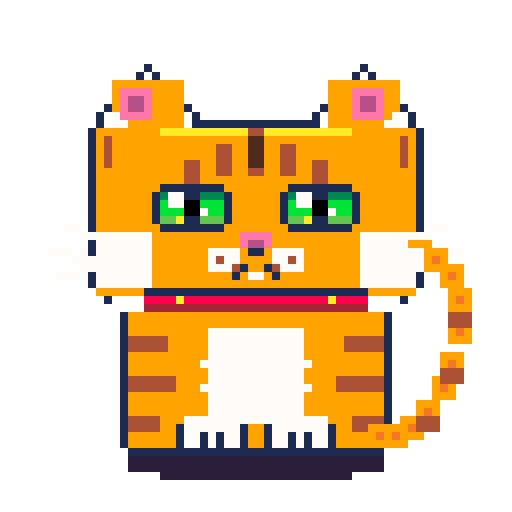
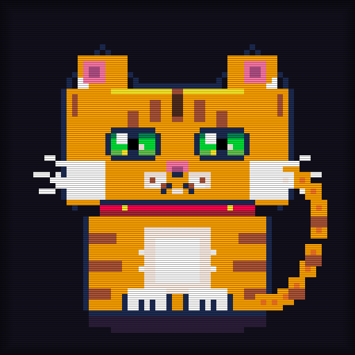
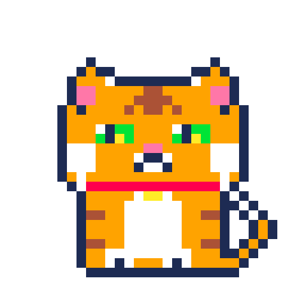
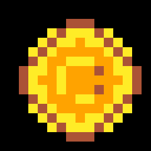

<div align="center">

# 👾 PixelMirai Agent
### Deterministic Pixel Art Engine & AI Agent Skill
**"Pixel art tak akan luntur oleh zaman."**  
*Pixel art will never fade with time. | ドット絵は時代に色褪せない。*

[](https://opensource.org/licenses/MIT)
[](https://github.com/riantosee/PixelMirai-Agent/actions)
[](https://www.python.org/downloads/)
[](https://github.com/riantosee/PixelMirai-Agent)
[-ff007f)](docs/pxm-format-spec.md)
[](https://github.com/riantosee)

<br/>

**[ 🇮🇩 Bahasa Indonesia ](#-bahasa-indonesia)** &nbsp;|&nbsp; 
**[ 🇬🇧 English ](#-english)** &nbsp;|&nbsp; 
**[ 🇯🇵 日本語 ](#-日本語)**

</div>

---

## 🎨 Gallery & Live Renders (Zero AI Slop)

Semua karya di bawah ini di-render secara **100% deterministik** menggunakan PixelMirai Engine melalui baris kode dan matematika integer pada grid diskrit:

| 🐱 Royal Calico Cat (64×64) | 📺 64×64 CRT Retro Edition |
|:---:|:---:|
|  |  |
| *2-Frame Idle + Blink & Tail Animation* | *CRT Phosphor Scanlines + Radial Vignette* |

| ⚔️ 8-Bit Knight (32×32) | 🐱 Classic Cat (32×32) | 🪙 Gold Coin (16×16) |
|:---:|:---:|:---:|
|  |  |  |
| *4-Frame Walk Cycle Loop* | *2-Frame Idle & Eye Blink* | *4-Frame 3D Spin Cycle* |

---

# 🇮🇩 Bahasa Indonesia

### 🌟 Filosofi: Murni Grid, Bebas AI Slop
Dalam era di mana model difusi generatif sering menghasilkan "AI Slop" (pixel kabur, subpixel tidak rata, warna pecah, tepi anti-aliasing yang merusak estetika retro), **PixelMirai Engine** hadir membawa filosofi keaslian:
1. **100% Integer Grid**: Setiap piksel terikat pada koordinat `(x, y)` bulat tanpa subpixel blur.
2. **Palette Terkunci**: Warna wajib bersumber dari palet konsol retro terkurasi (PICO-8, Endesga32, GameBoy, CGA).
3. **Format Asli `.pxm`**: Dilengkapi checksum FNV-1a 32-bit untuk integritas data.
4. **Agent Skill Ready**: Dapat langsung diadopsi oleh AI Agent (Antigravity, Claude, Cursor, Copilot) sebagai skill pembuatan sprite pixel art murni.

---

### ✨ Fitur Utama
- 📜 **PixelMirai DSL**: Bahasa script deklaratif sederhana (`pixel`, `rect`, `hline`, `vline`, `circle`, `fillcircle`).
- 🎬 **Multi-Frame Animation**: Dukungan penuh pembuatan animasi frame-by-frame yang langsung diexport menjadi GIF berulang mulus (*seamless loop*).
- 📺 **CRT Retro Filter**: Efek opsional scanlines CRT horizontal dan vignette sudut layar gaya monitor arcade tahun 80-an.
- 📦 **Format `.pxm`**: Format project berbasis JSON tervalidasi checksum FNV-1a 32-bit, kompatibel langsung dengan PixelMirai Studio web app.
- 🤖 **AI Agent Skill (`SKILL.md`)**: Siap digunakan langsung oleh LLM coding agent untuk memproduksi aset game 2D.

---

### 🚀 Panduan Memulai Cepat

#### 1. Prasyarat & Instalasi
Membutuhkan Python 3.10 atau lebih baru dan library Pillow:
```bash
git clone https://github.com/riantosee/PixelMirai-Agent.git
cd PixelMirai-Agent
pip install -r requirements.txt
```

#### 2. Menjalankan CLI Compiler
Compile file DSL menjadi PNG, GIF, CRT, dan file project `.pxm`:
```bash
# Compile contoh sprite kesatria 32x32
python scripts/pixelmirai_compiler.py examples/knight-32.pxm.dsl

# Export kucing 64x64 dengan CRT filter dan scale 8x
python scripts/pixelmirai_compiler.py examples/cat-64.pxm.dsl --crt --scale 8

# Hanya export format GIF animasi
python scripts/pixelmirai_compiler.py examples/coin-16.pxm.dsl --only gif
```

#### 3. Contoh Sintaks DSL (`examples/coin-16.pxm.dsl`)
```dsl
canvas 16 16
palette pico8
background transparent
scale 16
fps 10

frame 0
  layer "coin"
    fillcircle 8 8 6 #ffec27
    circle 8 8 6 #ab5236
    fillcircle 8 8 4 #ffa300

frame 1
  layer "coin"
    rect 5 2 6 12 #ffec27
    vline 5 2 13 #ab5236

export png "coin-16.png"
export gif "coin-16.gif"
export pxm "coin-16.pxm"
```

---

# 🇬🇧 English

### 🌟 Philosophy: Pure Grid, Zero AI-Slop
In an era dominated by generative diffusion models producing blurry "AI Slop"—uneven pixel grids, muddy palettes, anti-aliased artifacts, and broken retro aesthetics—**PixelMirai Engine** enforces genuine pixel art purity:
1. **100% Discrete Integer Grid**: Every single pixel is anchored strictly to integer coordinates `(x, y)` without floating-point bleed.
2. **Strict Curated Palettes**: Colors are constrained to authentic retro hardware palettes (PICO-8, Endesga32, Game Boy, CGA).
3. **Native `.pxm` Standard**: Lightweight JSON project files protected by a 32-bit FNV-1a checksum.
4. **Agent-Native Skill**: Directly empowers AI coding agents (Antigravity, Claude, Cursor, Copilot) to generate authentic 2D game assets.

---

### ✨ Core Features
- 📜 **PixelMirai DSL**: Clean declarative scripting language (`pixel`, `rect`, `hline`, `vline`, `circle`, `fillcircle`, `pixels`).
- 🎬 **Multi-Frame Animation**: Built-in timeline engine that compiles frame sequences into loopable GIFs.
- 📺 **CRT Retro Filter**: Authentic scanline darkening and radial vignette recreating classic 1980s arcade monitors.
- 💎 **True Alpha Transparency**: Declaring `background transparent` generates authentic 32-bit RGBA PNGs and transparent animated GIFs.
- 📦 **`.pxm` Project Standard & Round-Trip**: Verifiable JSON container holding layers, frames, palettes, and FNV-1a checksum. Supports both exporting and loading via `load_pxm()`.
- 🛡️ **Strict Syntax & Resource Bounds**: Catches malformed DSL, unknown commands, out-of-bounds coordinates, and invalid hex with line-accurate error reporting.
- 🤖 **Universal AI Agent Skill**: Provided with standard `SKILL.md` frontmatter for seamless LLM integration.

---

### 🚀 Quick Start Guide

#### 1. Installation & Environment Setup
Requires Python 3.10+ and Pillow:
```bash
git clone https://github.com/riantosee/PixelMirai-Agent.git
cd PixelMirai-Agent
pip install -r requirements.txt
```

To install development & testing dependencies:
```bash
pip install -r requirements-dev.txt
```

#### 2. Compiling DSL via CLI
Convert any `.pxm.dsl` file into PNG, GIF, CRT renders, and `.pxm` containers:
```bash
# Compile 8-bit knight sprite (default: strict validation)
python scripts/pixelmirai_compiler.py examples/knight-32.pxm.dsl

# Compile 64x64 cat with CRT filter and 8x upscale
python scripts/pixelmirai_compiler.py examples/cat-64.pxm.dsl --crt --scale 8

# Output only animated GIF
python scripts/pixelmirai_compiler.py examples/coin-16.pxm.dsl --only gif

# Lenient mode (skips invalid lines without terminating)
python scripts/pixelmirai_compiler.py my_sprite.pxm.dsl --lenient
```

#### 3. Python API Usage
You can also use the compiler programmatically inside Python applications:
```python
from scripts.pixelmirai_compiler import PixelMiraiEngine

# Initialize 32x32 canvas
engine = PixelMiraiEngine(width=32, height=32)
engine.set_palette('pico8')
engine.set_background('transparent')  # True RGBA transparency

# Draw on frame 0
frame = engine.new_frame(0)
layer = frame.new_layer('character')
layer.rect(10, 10, 12, 12, '#ffa300')
layer.pixel(14, 14, '#00e436')

# Export formats
engine.export_png('output.png', scale=12)
engine.export_pxm('output.pxm')

# Load and verify existing .pxm project file
loaded = PixelMiraiEngine.load_pxm('output.pxm', verify_checksum=True)
print(f"Loaded {loaded.name} with {len(loaded.frames)} frame(s)!")
```

#### 4. Running Automated Tests
Run the comprehensive 26-test suite covering parser, validation, transparency, exports, and CLI behavior:
```bash
pytest tests/ -v
```

---

# 🇯🇵 日本語

### 🌟 開発理念：純粋なグリッド、AIスロップの完全排除
現代の生成AI（拡散モデル）が生成する「ドット絵風画像」には、サブピクセルのにじみ、混濁したカラーパレット、不自然なアンチエイリアスなどの「AIスロップ（粗悪なAI生成物）」が頻繁に見られます。  
**PixelMirai Engine** は、クラシックゲームの純粋な美学を取り戻すために開発されました：
1. **完全な整数グリッド (100% Integer Grid)**：すべてのドットは厳密な整数座標 `(x, y)` に配置され、ぼやけやズレは一切ありません。
2. **厳格なカラーパレット**：PICO-8、Endesga32、ゲームボーイ、CGAなど、時代を彩った名機のカラーパレットのみを使用。
3. **独自プロジェクト形式 `.pxm`**：改ざん防止と整合性のための FNV-1a 32ビットチェックサムを搭載。
4. **AIエージェント対応スキル**：Google Antigravity、Claude、Cursor などのAIエージェントが自律的に本物のドット絵を生成できる `SKILL.md` を完備。

---

### ✨ 主な機能
- 📜 **PixelMirai DSL**：直感的でわかりやすい宣言型スクリプト言語。
- 🎬 **マルチフレームアニメーション**：複数フレームを記述するだけで、スムーズにループするGIFアニメーションを出力。
- 📺 **CRTレトロフィルター**：アーケード筐体やブラウン管テレビのスキャンラインと周辺減光を美しくシミュレート。
- 📦 **`.pxm` プロジェクト仕様**：レイヤー構造やパレットを保持し、PixelMirai Web Studio と双方向連携可能。

---

### 🚀 クイックスタート

#### 1. インストール
Python 3.10以上とPillowが必要です：
```bash
git clone https://github.com/riantosee/PixelMirai-Agent.git
cd PixelMirai-Agent
pip install -r requirements.txt
```

#### 2. CLIコンパイラの使用例
```bash
# 32x32 ナイト（歩行ループ）のビルド
python scripts/pixelmirai_compiler.py examples/knight-32.pxm.dsl

# 64x64 ネコ（CRTスキャンライン付き）
python scripts/pixelmirai_compiler.py examples/cat-64.pxm.dsl --crt --scale 8

# アニメーションGIFのみを出力
python scripts/pixelmirai_compiler.py examples/coin-16.pxm.dsl --only gif
```

---

## 📁 Project Structure

```
PixelMirai-Agent/
├── .agents/
│   └── skills/
│       └── pixelmirai/
│           ├── SKILL.md                 # Agent Skill definition & system instructions
│           ├── examples/                # Sample DSL scripts for agent training
│           └── references/              # Color palettes & format specifications
├── assets/                              # High-resolution showcase GIFs and renders
│   ├── cat-64.gif
│   ├── cat-64-crt.png
│   ├── cat-32.gif
│   ├── knight-32.gif
│   └── coin-16.gif
├── docs/                                # Technical specifications
│   ├── dsl-specification.md
│   ├── palette-endesga32.md
│   └── pxm-format-spec.md
├── examples/                            # Ready-to-compile DSL sprite samples
│   ├── cat-64.pxm.dsl
│   ├── cat-32.pxm.dsl
│   ├── knight-32.pxm.dsl
│   └── coin-16.pxm.dsl
├── scripts/
│   ├── pixelmirai_compiler.py           # Core CLI and Python compilation engine
│   ├── generate_cat_art.py              # Procedural 32x32 generator
│   └── generate_cat_64.py               # Procedural 64x64 generator
├── SKILL.md                             # Root Agent Skill entrypoint
├── requirements.txt                     # Dependencies (Pillow)
├── LICENSE                              # MIT License
└── README.md                            # Trilingual documentation & showcase
```

---

## 👨‍💻 Creator & Socials

Created with passion by **Rian (@riantosee / @RianFix)**  
- 🐙 **GitHub**: [@riantosee](https://github.com/riantosee) & [@RianFix](https://github.com/RianFix)
- 📸 **Instagram**: [@bisarianbisaryan](https://www.instagram.com/bisarianbisaryan/)

*"Pixel art tak akan luntur oleh zaman. Abadi di setiap era, murni di setiap grid."*

---

## 📄 License
This project is open-source under the terms of the [MIT License](LICENSE).
